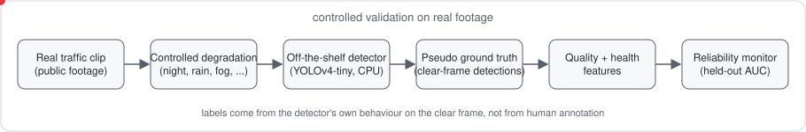
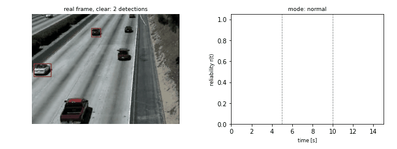
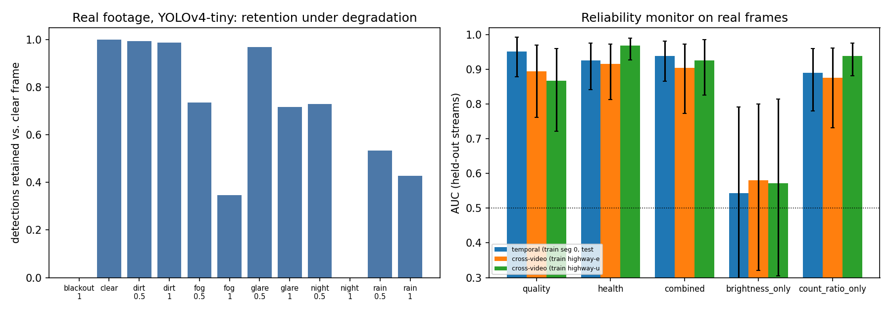

# real-footage-perception-validation

**A controlled check of camera-reliability monitoring on real road footage with an off-the-shelf detector.**

Three sibling repositories evaluate perception components on *simulated* inputs. This repository asks the
obvious follow-up: do the conclusions about the reliability monitor
([`perception-reliability-monitor`](https://github.com/soheylfalahzade/perception-reliability-monitor)) survive
when the frames are **real** and the detector is a standard, unmodified network? Real highway clips are
degraded in a controlled way (night, rain, fog, glare, lens dirt, blackout), a pre-trained YOLOv4-tiny is run
on every frame, and the monitor is trained and tested on held-out streams. Nothing is trained on detection
data and no human labels are used (see *Labels*).

[](https://github.com/soheylfalahzade/real-footage-perception-validation/actions)


<p align="center"></p>

<p align="center"></p>

<sub>Animation: a real highway clip (the US clip) that becomes rainy at 4 s and stays degraded
until 8 s; red boxes are detections of the unmodified detector, the curve is the reliability score of a monitor
fitted on the *other* clip. Regenerate with `rfv-gif`.</sub>

## Labels without annotation

For each frame, the detections of the clear (undegraded) frame with score >= 0.5 serve as **pseudo ground
truth**. A degraded frame *retains* a box if a detection overlaps it (IoU >= 0.5); a frame is *reliable* if the
rolling (15-frame) retention is at least 0.6. The label therefore measures how much of what the detector
sees in clear conditions it still sees; it is not detection accuracy against human annotation. Details:
[`docs/METHODS.md`](docs/METHODS.md).

## Setup

Two public highway clips (downloaded at run time, checksummed, not redistributed): an EU motorway
(1280 x 720, 29.97 fps) and a US freeway camera (320 x 240, 15 fps). Two 60-frame segments per clip at 5 fps,
12 streams per segment (clear, five degradations at severities 0.5 and 1.0, blackout), 48 streams and
2,208 evaluated frames in total. Detector: YOLOv4-tiny (Darknet weights) via OpenCV on one CPU thread, 608 px
input. The clear streams contain 240 pseudo-GT boxes (about one to three vehicles per frame): traffic is light.

## Results

**Detector behaviour on degraded real frames** (retention of clear-frame detections; count ratio = detections /
pseudo-GT; reliable = share of frames labelled reliable):

| stream | retention | count ratio | reliable frames |
|---|---|---|---|
| blackout 1 | 0.000 | 0.00 | 0.00 |
| clear | 1.000 | 1.61 | 1.00 |
| dirt 0.5 | 0.994 | 1.60 | 0.97 |
| dirt 1 | 0.987 | 1.60 | 0.97 |
| fog 0.5 | 0.736 | 0.97 | 0.83 |
| fog 1 | 0.346 | 0.42 | 0.09 |
| glare 0.5 | 0.969 | 1.45 | 1.00 |
| glare 1 | 0.717 | 0.97 | 0.83 |
| night 0.5 | 0.730 | 0.96 | 0.83 |
| night 1 | 0.000 | 0.00 | 0.00 |
| rain 0.5 | 0.535 | 0.77 | 0.43 |
| rain 1 | 0.428 | 0.68 | 0.13 |

The unmodified detector is insensitive to lens dirt and mild glare, loses roughly half of its detections in
rain (0.535 and 0.428) and in dense fog (0.346), and fails completely at night 1.0 and in a blackout. Night 0.5
and fog 0.5 are survived (0.73).

**Reliability monitor on held-out streams** (AUC with 95% bootstrap intervals over streams; ECE with 10 bins):

| split | features | AUC [95% CI] | ECE |
|---|---|---|---|
| temporal (train segment 0, test segment 1) | quality | 0.952 [0.879, 0.993] | 0.052 |
| temporal (train segment 0, test segment 1) | health | 0.926 [0.842, 0.976] | 0.050 |
| temporal (train segment 0, test segment 1) | combined | 0.939 [0.866, 0.982] | 0.074 |
| temporal (train segment 0, test segment 1) | brightness only | 0.544 [0.284, 0.791] | 0.159 |
| temporal (train segment 0, test segment 1) | count ratio only | 0.890 [0.780, 0.959] | 0.084 |
| cross-video: train EU clip, test US clip | quality | 0.895 [0.761, 0.970] | 0.130 |
| cross-video: train EU clip, test US clip | health | 0.916 [0.813, 0.974] | 0.183 |
| cross-video: train EU clip, test US clip | combined | 0.905 [0.774, 0.973] | 0.224 |
| cross-video: train EU clip, test US clip | brightness only | 0.581 [0.321, 0.800] | 0.136 |
| cross-video: train EU clip, test US clip | count ratio only | 0.877 [0.732, 0.962] | 0.227 |
| cross-video: train US clip, test EU clip | quality | 0.867 [0.722, 0.960] | 0.225 |
| cross-video: train US clip, test EU clip | health | 0.968 [0.928, 0.989] | 0.122 |
| cross-video: train US clip, test EU clip | combined | 0.926 [0.826, 0.986] | 0.154 |
| cross-video: train US clip, test EU clip | brightness only | 0.572 [0.306, 0.815] | 0.174 |
| cross-video: train US clip, test EU clip | count ratio only | 0.938 [0.881, 0.976] | 0.122 |



- Image-quality features and detector-health features each predict reliability on held-out streams
  (AUC 0.87-0.97). Combining them does not help beyond the better single family at this sample size.
- A single global feature, mean brightness, is close to chance (0.54-0.58): the monitor needs more than an
  obvious darkness check (night 0.5 is survivable, fog 1.0 is not, and both change brightness).
- A trivial *detector count ratio* baseline is competitive (0.88-0.94); the monitor is not shown to beat it.
- Discrimination transfers between clips (cross-video AUC 0.87-0.97) but **calibration does not**: ECE rises from
  about 0.05 (same clips, other segment) to 0.12-0.23 (other clip). A deployment needs per-site recalibration.

## Claims and evidence

| claim | evidence | file |
|---|---|---|
| a real off-the-shelf detector degrades under the modelled conditions | retention 0.43-0.54 (rain), 0.35 (fog 1.0), 0 (night 1.0, blackout) | `docs/results/analysis.json` |
| the monitor predicts detector reliability on real frames | held-out AUC 0.87-0.97 for quality, health and combined features | `docs/results/analysis.json` |
| the monitor beats simple baselines | **partially supported**: beats brightness-only (about 0.55); not shown to beat the count-ratio baseline | `docs/results/analysis.json` |
| probabilities transfer across sites | **not supported**: ECE 0.12-0.23 across clips | `docs/results/analysis.json` |
| monitoring improves control on real footage | **not tested** | |

## Threats to validity

- *Construct*: labels come from the detector's own clear-frame detections, not from human annotation; they
  capture robustness, not accuracy. Degradations are synthetic transformations of real frames (the night
  model has no headlight layer, rain is drawn streaks), not recorded adverse weather.
- *Internal*: 240 pseudo-GT boxes over four segments; most evaluated windows contain a handful of boxes.
  Stream-level bootstrap intervals are wide (width 0.1-0.25).
- *External*: two light-traffic highway clips from fixed cameras, one detector (YOLOv4-tiny); no urban
  intersections, no queues, no emergency vehicles.
- *Statistical*: frames of one stream are strongly dependent; intervals resample whole streams.

## Installation (Ubuntu / WSL2)

```bash
python3 -m venv .venv && source .venv/bin/activate
pip install -e ".[dev]"
pytest
```

## Usage (CPU only, one thread)

```bash
rfv-preflight --data-dir data                 # RAM / load check and run-time estimate
rfv-fetch --data-dir data                      # download and verify the public files
nice -n 19 rfv-run --data-dir data --out results/frames.csv    # 10-15 min, one core
rfv-analyze --frames results/frames.csv --out results
rfv-analyze --frames docs/results/frames.csv --out results     # re-analyse the shipped detections in seconds
```

`docs/results/frames.csv` holds the per-frame detector statistics and features of the reported run, so the
tables and figure can be regenerated without running the detector.

## Data and code availability

All code, the per-frame result table and the analysis outputs are in this repository. The video clips and
the detector weights are public files fetched at run time from their original repositories and verified by
SHA-256; their licences are set by those repositories and they are not redistributed here. Commands and
runtimes: [`docs/REPRODUCIBILITY.md`](docs/REPRODUCIBILITY.md).

## Roadmap

Human-annotated frames for the same clips; recorded adverse-weather footage; an urban signalised approach
with queues (to connect to `occlusion-aware-queue-estimation`); a modern detector and ByteTrack health
signals; per-site recalibration of the monitor.

## Citation

See [`CITATION.cff`](CITATION.cff).

## License

MIT. See [LICENSE](LICENSE).
