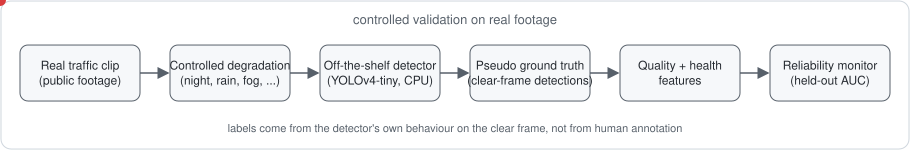
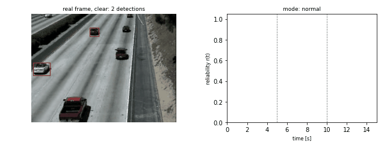
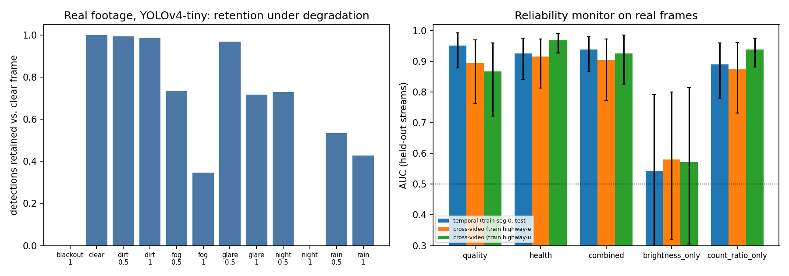
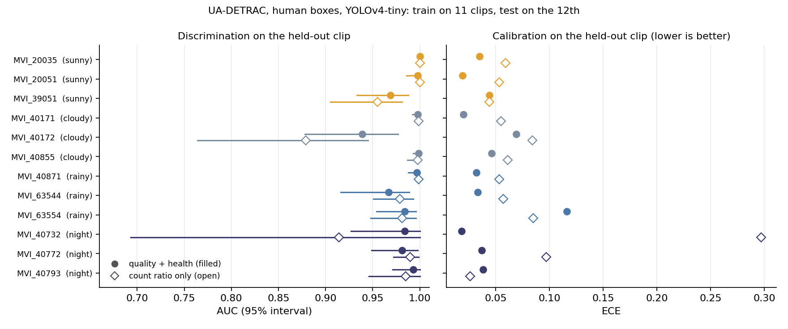

# real-footage-perception-validation

<!-- banner -->
<p align="center"></p>


**A controlled check of camera-reliability monitoring on real road footage with an off-the-shelf detector.**

Three sibling repositories evaluate perception components on *simulated* inputs. This repository asks the
obvious follow-up: do the conclusions about the reliability monitor
([`perception-reliability-monitor`](https://github.com/soheylfalahzade/perception-reliability-monitor)) survive
when the frames are **real** and the detector is a standard, unmodified network? Real highway clips are
degraded in a controlled way (night, rain, fog, glare, lens dirt, blackout), a pre-trained YOLOv4-tiny is run
on every frame, and the monitor is trained and tested on held-out streams. Nothing is trained on detection
data and no human labels are used (see *Labels*).

[](https://github.com/soheylfalahzade/real-footage-perception-validation/actions)


<p align="center"></p>

<p align="center"></p>

<sub>Animation: a real highway clip (the US clip) that becomes rainy at 4 s and stays degraded
until 8 s; red boxes are detections of the unmodified detector, the curve is the reliability score of a monitor
fitted on the *other* clip. Regenerate with `rfv-gif`.</sub>

## Labels without annotation

For each frame, the detections of the clear (undegraded) frame with score >= 0.5 serve as **pseudo ground
truth**. A degraded frame *retains* a box if a detection overlaps it (IoU >= 0.5); a frame is *reliable* if the
rolling (15-frame) retention is at least 0.6. The label therefore measures how much of what the detector
sees in clear conditions it still sees; it is not detection accuracy against human annotation. Details:
[`docs/METHODS.md`](docs/METHODS.md).

## Setup

Two public highway clips (downloaded at run time, checksummed, not redistributed): an EU motorway
(1280 x 720, 29.97 fps) and a US freeway camera (320 x 240, 15 fps). Two 60-frame segments per clip at 5 fps,
12 streams per segment (clear, five degradations at severities 0.5 and 1.0, blackout), 48 streams and
2,208 evaluated frames in total. Detector: YOLOv4-tiny (Darknet weights) via OpenCV on one CPU thread, 608 px
input. The clear streams contain 240 pseudo-GT boxes (about one to three vehicles per frame): traffic is light.

## Results

**Detector behaviour on degraded real frames** (retention of clear-frame detections; count ratio = detections /
pseudo-GT; reliable = share of frames labelled reliable):

| stream | retention | count ratio | reliable frames |
|---|---|---|---|
| blackout 1 | 0.000 | 0.00 | 0.00 |
| clear | 1.000 | 1.61 | 1.00 |
| dirt 0.5 | 0.994 | 1.60 | 0.97 |
| dirt 1 | 0.987 | 1.60 | 0.97 |
| fog 0.5 | 0.736 | 0.97 | 0.83 |
| fog 1 | 0.346 | 0.42 | 0.09 |
| glare 0.5 | 0.969 | 1.45 | 1.00 |
| glare 1 | 0.717 | 0.97 | 0.83 |
| night 0.5 | 0.730 | 0.96 | 0.83 |
| night 1 | 0.000 | 0.00 | 0.00 |
| rain 0.5 | 0.535 | 0.77 | 0.43 |
| rain 1 | 0.428 | 0.68 | 0.13 |

The unmodified detector is insensitive to lens dirt and mild glare, loses roughly half of its detections in
rain (0.535 and 0.428) and in dense fog (0.346), and fails completely at night 1.0 and in a blackout. Night 0.5
and fog 0.5 are survived (0.73).

**Reliability monitor on held-out streams** (AUC with 95% bootstrap intervals over streams; ECE with 10 bins):

| split | features | AUC [95% CI] | ECE |
|---|---|---|---|
| temporal (train segment 0, test segment 1) | quality | 0.952 [0.879, 0.993] | 0.052 |
| temporal (train segment 0, test segment 1) | health | 0.926 [0.842, 0.976] | 0.050 |
| temporal (train segment 0, test segment 1) | combined | 0.939 [0.866, 0.982] | 0.074 |
| temporal (train segment 0, test segment 1) | brightness only | 0.544 [0.284, 0.791] | 0.159 |
| temporal (train segment 0, test segment 1) | count ratio only | 0.890 [0.780, 0.959] | 0.084 |
| cross-video: train EU clip, test US clip | quality | 0.895 [0.761, 0.970] | 0.130 |
| cross-video: train EU clip, test US clip | health | 0.916 [0.813, 0.974] | 0.183 |
| cross-video: train EU clip, test US clip | combined | 0.905 [0.774, 0.973] | 0.224 |
| cross-video: train EU clip, test US clip | brightness only | 0.581 [0.321, 0.800] | 0.136 |
| cross-video: train EU clip, test US clip | count ratio only | 0.877 [0.732, 0.962] | 0.227 |
| cross-video: train US clip, test EU clip | quality | 0.867 [0.722, 0.960] | 0.225 |
| cross-video: train US clip, test EU clip | health | 0.968 [0.928, 0.989] | 0.122 |
| cross-video: train US clip, test EU clip | combined | 0.926 [0.826, 0.986] | 0.154 |
| cross-video: train US clip, test EU clip | brightness only | 0.572 [0.306, 0.815] | 0.174 |
| cross-video: train US clip, test EU clip | count ratio only | 0.938 [0.881, 0.976] | 0.122 |



- Image-quality features and detector-health features each predict reliability on held-out streams
  (AUC 0.87-0.97). Combining them does not help beyond the better single family at this sample size.
- A single global feature, mean brightness, is close to chance (0.54-0.58): the monitor needs more than an
  obvious darkness check (night 0.5 is survivable, fog 1.0 is not, and both change brightness).
- A trivial *detector count ratio* baseline is competitive (0.88-0.94); the monitor is not shown to beat it.
- Discrimination transfers between clips (cross-video AUC 0.87-0.97) but **calibration does not**: ECE rises from
  about 0.05 (same clips, other segment) to 0.12-0.23 (other clip). A deployment needs per-site recalibration.

## Claims and evidence

| claim | evidence | file |
|---|---|---|
| a real off-the-shelf detector degrades under the modelled conditions | retention 0.43-0.54 (rain), 0.35 (fog 1.0), 0 (night 1.0, blackout) | `docs/results/analysis.json` |
| the monitor predicts detector reliability on real frames | held-out AUC 0.87-0.97 for quality, health and combined features | `docs/results/analysis.json` |
| the monitor beats simple baselines | **partially supported**: beats brightness-only (about 0.55); not shown to beat the count-ratio baseline | `docs/results/analysis.json` |
| probabilities transfer across sites | **not supported**: ECE 0.12-0.23 across clips | `docs/results/analysis.json` |
| the monitor works against human-labelled boxes (UA-DETRAC, 12 clips) | temporal split combined AUC 0.973 [0.957, 0.985]; leave-one-clip-out median 0.989, worst 0.939 | `docs/results/analysis_detrac.json` |
| the monitor beats a detector-count baseline on human boxes | **partially supported**: 0.973 [0.957, 0.985] vs 0.947 [0.918, 0.969], intervals overlap; worst clip 0.939 vs 0.879 | `docs/results/analysis_detrac.json` |
| probabilities transfer across clips with human boxes | **partially supported**: leave-one-clip-out ECE median 0.036, worst 0.116 (a rainy clip) | `docs/results/analysis_detrac.json` |
| monitoring improves control on real footage | **not tested** | |

## Threats to validity

- *Construct*: labels come from the detector's own clear-frame detections, not from human annotation; they
  capture robustness, not accuracy. Degradations are synthetic transformations of real frames (the night
  model has no headlight layer, rain is drawn streaks), not recorded adverse weather.
- *Internal*: 240 pseudo-GT boxes over four segments; most evaluated windows contain a handful of boxes.
  Stream-level bootstrap intervals are wide (width 0.1-0.25).
- *External*: two light-traffic highway clips from fixed cameras, one detector (YOLOv4-tiny); no urban
  intersections, no queues, no emergency vehicles.
- *Statistical*: frames of one stream are strongly dependent; intervals resample whole streams.

## Installation (Ubuntu / WSL2)

```bash
python3 -m venv .venv && source .venv/bin/activate
pip install -e ".[dev]"
pytest
```

## Usage (CPU only, one thread)

```bash
rfv-preflight --data-dir data                 # RAM / load check and run-time estimate
rfv-fetch --data-dir data                      # download and verify the public files
nice -n 19 rfv-run --data-dir data --out results/frames.csv    # 10-15 min, one core
rfv-analyze --frames results/frames.csv --out results
rfv-analyze --frames docs/results/frames.csv --out results     # re-analyse the shipped detections in seconds
```

`docs/results/frames.csv` holds the per-frame detector statistics and features of the reported run, so the
tables and figure can be regenerated without running the detector.

## Data and code availability

All code, the per-frame result table and the analysis outputs are in this repository. The video clips and
the detector weights are public files fetched at run time from their original repositories and verified by
SHA-256; their licences are set by those repositories and they are not redistributed here. Commands and
runtimes: [`docs/REPRODUCIBILITY.md`](docs/REPRODUCIBILITY.md).

## Human-labelled ground truth (UA-DETRAC)

The pseudo ground truth of the main experiment measures robustness, not accuracy. With a local copy of
[UA-DETRAC](https://detrac-db.rit.albany.edu/) (fixed roadside cameras, human-labelled vehicle boxes, and a
weather label per sequence: sunny, cloudy, rainy, night) the same protocol can be run against human boxes:

```bash
# 1. encode clips and extract ground truth (3 sequences per weather class, first 600 frames each)
rfv-detrac --root /mnt/d/hitman/Dataset/UA-DETRAC --out clips --per-weather 3
# 2. run the protocol on them (add --detector yolov8n-onnx for the second detector)
rfv-run --data-dir data --extra-dir clips --only-extra --out results/frames_detrac.csv
rfv-analyze --frames results/frames_detrac.csv --out results_detrac
```

Ground-truth boxes below 20 px height (at 640 px width) and boxes whose centre lies in an annotated ignored
region are dropped. A frame window is labelled reliable when its recall against the human boxes is at least
0.6 times the recall of the *undegraded* stream of the same clip segment, so that vehicles an off-the-shelf
detector never finds do not count as degradation. With pseudo ground truth that reference recall is 1.0 and the
label is unchanged. UA-DETRAC is not redistributed here; follow its terms of use.

### Results with human ground truth

12 UA-DETRAC clips (3 sunny, 3 cloudy, 3 rainy, 3 night; 600 frames each, two 60-frame segments), the same 12
degradation streams per segment, YOLOv4-tiny: 288 streams, 13,248 frames, 69.6 % of frames labelled reliable.
Intervals are bootstrap intervals over streams; frames within a stream are strongly dependent, so they are
optimistic.

| split | features | AUC [95% CI] | ECE |
|---|---|---|---|
| temporal (train segment 0, test segment 1) | quality | 0.932 [0.894, 0.961] | 0.046 |
| | health | 0.969 [0.952, 0.982] | 0.021 |
| | combined | 0.973 [0.957, 0.985] | 0.016 |
| | brightness only | 0.660 [0.544, 0.769] | 0.095 |
| | detector count ratio only | 0.947 [0.918, 0.969] | 0.075 |

Leave-one-clip-out (train on 11 clips, test on the twelfth), over the 12 test clips:

| features | AUC median | AUC range | ECE median | ECE range |
|---|---|---|---|---|
| quality | 0.969 | 0.863 to 1.000 | 0.092 | 0.068 to 0.205 |
| health | 0.988 | 0.937 to 1.000 | 0.036 | 0.023 to 0.103 |
| combined | 0.989 | 0.939 to 1.000 | 0.036 | 0.018 to 0.116 |
| brightness only | 0.662 | 0.556 to 0.883 | 0.122 | 0.092 to 0.155 |
| detector count ratio only | 0.988 | 0.879 to 1.000 | 0.058 | 0.026 to 0.297 |

<p align="center"></p>

*Per held-out clip: AUC with 95% bootstrap interval (left) and ECE (right) for the combined features (filled) and
the detector-count baseline (open), coloured by the clip's weather label. The per-clip values are transcribed from
the `rfv-analyze` output into `docs/results/detrac_leave_one_clip_out.csv`; regenerate the figure with `rfv-figures`.*

The weakest clip for the combined and the health features is MVI_40172 (cloudy); the worst calibration of the
combined features is on MVI_63554 (rainy, ECE 0.116). The count-ratio baseline is close to the combined features
in the median and clearly worse in the worst case (AUC 0.879 on MVI_40172, ECE 0.297 on MVI_40732, a night clip).
Against human boxes, calibration transferred across clips far better (median ECE 0.036) than across the two
pseudo-ground-truth clips above (0.12 to 0.23); the two experiments differ in clips, labels and number of
training clips, so this is not a controlled comparison. The degradations remain synthetic.

## Extending the evaluation

```bash
# a second, more recent off-the-shelf detector (export once, then place the file in data/)
pip install ultralytics && yolo export model=yolov8n.pt format=onnx imgsz=640 opset=12
cp yolov8n.onnx data/

# any additional footage: a folder of clips, e.g. one per camera or per city
rfv-run --data-dir data --extra-dir clips --detector yolov8n-onnx --out results/frames_v8.csv
rfv-analyze --frames results/frames_v8.csv --out results_v8
```

With three or more clips the cross-video split is leave-one-video-out. See `docs/METHODS.md`, section 7.

## Roadmap

Human-annotated frames for the same clips; recorded adverse-weather footage; an urban signalised approach
with queues (to connect to `occlusion-aware-queue-estimation`); a modern detector and ByteTrack health
signals; per-site recalibration of the monitor.

## Citation

See [`CITATION.cff`](CITATION.cff).

## License

MIT. See [LICENSE](LICENSE).
